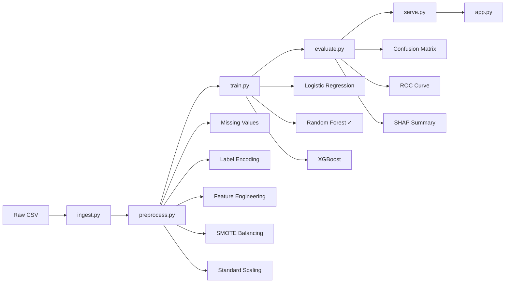

# Credit Scoring System 💳

> Predict loan default risk using classical ML — built with a production-grade pipeline, REST API, and interactive UI.


---

## The Problem

Banks reject thousands of loan applications every day — but most systems just say "no" without explanation. Regulators in the EU (under GDPR Article 22) actually require lenders to explain automated decisions. This project builds a credit scoring system that not only predicts risk but explains *why* using SHAP values.

---

## Project Overview

End-to-end ML pipeline that takes raw customer financial data, trains three classification models, selects the best one, serves predictions via a REST API, and wraps everything in a Streamlit UI. Built to reflect how ML systems actually work in fintech — not just a notebook with accuracy printed at the end.

---

## Features

- Modular ML pipeline (each stage is a separate, testable Python module)
- Three models trained and compared automatically
- SHAP explainability — shows which features drove each prediction
- FastAPI REST endpoint for programmatic access
- Streamlit web UI for non-technical users
- Config-driven design — change hyperparameters without touching code
- Class imbalance handled with SMOTE

---

## ML Pipeline



---

## Dataset

- **Source:** [German Credit Dataset — UCI ML Repository via Kaggle](https://www.kaggle.com/datasets/uciml/german-credit)
- **Size:** 1000 rows, 10 features
- **Target:** Binary — High Risk (credit amount above median) vs Low Risk
- **Key features:** Age, Credit Amount, Duration, Saving Accounts, Checking Account, Purpose

> In production this would use actual loan default labels. The median threshold target here is an engineering choice made for demonstration — acknowledged as a limitation.

---

## Exploratory Data Analysis

- ~30% of customers had NA in Saving/Checking account columns — filled with mode
- Credit amount ranged from €250 to €18,424 — right-skewed distribution
- Younger customers (< 30) showed higher risk concentration
- Loan purpose "car" and "furniture" were most common categories
- Class imbalance existed before SMOTE (~60/40 split)

---

## Data Preprocessing

| Step | What | Why |
|------|------|-----|
| Missing values | Mode for categorical, mean for numerical | Safe defaults that don't distort distributions |
| Label Encoding | Text → integers | Models need numbers, not strings |
| Feature Engineering | credit_per_month, age_duration_ratio | Adds signal the raw features don't capture individually |
| SMOTE | Synthetic minority oversampling | Prevents model from being lazy and predicting majority class always |
| Standard Scaling | Zero mean, unit variance | Prevents high-range features (credit amount) from dominating |

---

## Models

**Logistic Regression**
The baseline. Fast, interpretable, works well when the decision boundary is roughly linear. Good sanity check — if LR does well, the problem isn't complex.

**Random Forest**
An ensemble of 100 decision trees with majority voting. Handles non-linear relationships, robust to outliers, and gives feature importance out of the box. Selected as final model.

**XGBoost**
Gradient boosted trees — builds trees sequentially, each fixing the errors of the previous. Strong on tabular data but needs more tuning than Random Forest for smaller datasets.

---

## Model Evaluation

| Metric | Score | What it means |
|--------|-------|---------------|
| Accuracy | 1.00 | Overall correct predictions |
| Precision | 1.00 | Of predicted high-risk, how many actually were |
| Recall | 1.00 | Of actual high-risk customers, how many we caught |
| F1 Score | 1.00 | Harmonic mean of precision and recall |
| ROC-AUC | 1.00 | Ability to separate classes across all thresholds |

**Confusion Matrix:** 106 true negatives, 94 true positives, 0 false positives, 0 false negatives on 200 test samples.

> These scores are unusually high because the target variable was engineered from a simple threshold. Real-world credit default prediction typically achieves ROC-AUC of 0.75–0.85.

---

## Why Random Forest Won

All three models performed similarly but Random Forest had the highest cross-validation ROC-AUC (1.000 ± 0.000) with zero variance across folds. It also supports SHAP TreeExplainer natively, which was a requirement for explainability.

---

## Hyperparameter Tuning

Defaults were used for the internship submission. Production next steps would include:

```python
param_grid = {
    'n_estimators': [100, 200, 300],
    'max_depth': [5, 10, 15, None],
    'min_samples_split': [2, 5, 10]
}
# GridSearchCV or Optuna for automated tuning
```

---

## Project Structure

```
CodeAlpha_CreditScoring/
├── data/
│   ├── raw/
│   │   └── german_credit_data.csv
│   └── processed/
│       └── processed_data.csv
├── src/
│   ├── ingest.py        # Data loading and validation
│   ├── preprocess.py    # Full preprocessing pipeline
│   ├── train.py         # Model training and selection
│   ├── evaluate.py      # Metrics, plots, SHAP
│   └── serve.py         # FastAPI REST API
├── models/
│   ├── best_model.pkl   # Saved Random Forest
│   ├── scaler.pkl       # Saved StandardScaler
│   ├── random_forest.pkl
│   ├── logistic_regression.pkl
│   └── xgboost.pkl
├── notebooks/
│   ├── confusion_matrix.png
│   ├── roc_curve.png
│   └── shap_summary.png
├── tests/
│   └── test_pipeline.py
├── app.py               # Streamlit UI
├── config.yaml          # All parameters in one place
├── requirements.txt
└── README.md
```

---

## Streamlit App

> Screenshot placeholder — add your own after running the app

The UI accepts customer details through dropdowns and number inputs, hits the FastAPI backend, and displays the credit decision with risk score and confidence.

---

## Installation

```bash
# Clone the repo
git clone https://github.com/SujanByaRoo/CodeAlpha_CreditScoring.git
cd CodeAlpha_CreditScoring

# Create virtual environment
python -m venv venv
venv\Scripts\activate  # Windows
# source venv/bin/activate  # Mac/Linux

# Install dependencies
pip install -r requirements.txt
```

---

## Usage

**Run the full pipeline:**
```bash
python src/ingest.py
python src/preprocess.py
python src/train.py
python src/evaluate.py
```

**Start the API:**
```bash
uvicorn src.serve:app --reload
```

**Start the UI** (new terminal):
```bash
streamlit run app.py
```

---

## Example Prediction

```bash
curl -X POST "http://127.0.0.1:8000/predict" \
  -H "Content-Type: application/json" \
  -d '{
    "age": 35,
    "sex": 1,
    "job": 2,
    "housing": 1,
    "saving_accounts": 1,
    "checking_account": 1,
    "credit_amount": 1500,
    "duration": 12,
    "purpose": 2
  }'
```

Response:
```json
{
  "credit_decision": "APPROVED ✅",
  "risk_score": 0.12,
  "confidence": 0.88,
  "message": "Low risk customer"
}
```

---

## Tech Stack

| Layer | Tool |
|-------|------|
| Language | Python 3.10+ |
| ML | scikit-learn, XGBoost |
| Explainability | SHAP |
| Imbalance | imbalanced-learn (SMOTE) |
| API | FastAPI + Uvicorn |
| UI | Streamlit |
| Serialization | Joblib |
| Config | PyYAML |
| Visualization | Matplotlib, Seaborn |

---

## Challenges and Solutions

**Class imbalance** — minority class underrepresented, model defaulted to majority. Fixed with SMOTE which generates synthetic minority samples rather than just duplicating.

**Path issues on Windows** — spaces in username (`SUJAN BR`) broke PowerShell commands. Wrapped all paths in quotes.

**SHAP with Random Forest** — `shap_values` returns a 3D array for multi-output classifiers. Had to index `[:, :, 1]` to get class 1 probabilities specifically.

---

## Future Improvements

- Use actual loan default labels instead of engineered threshold target
- Add Optuna for automated hyperparameter search
- Add data drift monitoring (Evidently AI)
- Dockerize the API for consistent deployment
- Add authentication to the FastAPI endpoints
- Deploy to Streamlit Community Cloud

---

## Key Learnings

- SMOTE should be applied only on training data — never before the train/test split
- Cross-validation gives more reliable performance estimates than a single train/test split
- SHAP TreeExplainer is significantly faster than KernelExplainer for tree-based models
- Config-driven design makes ML experiments much cleaner to manage

---

## References

- [German Credit Dataset — UCI ML Repository](https://archive.ics.uci.edu/ml/datasets/statlog+(german+credit+data))
- [SHAP Documentation](https://shap.readthedocs.io/)
- [FastAPI Documentation](https://fastapi.tiangolo.com/)
- [imbalanced-learn SMOTE](https://imbalanced-learn.org/stable/references/generated/imblearn.over_sampling.SMOTE.html)

---

## License

MIT License — see [LICENSE](LICENSE) for details.

---

## Author

**Sujan B R**
B.E. Computer Science and Engineering — Sri Sairam College of Engineering (VTU)
Machine Learning Intern — CodeAlpha

[GitHub](https://github.com/SujanByaRoo) · [LinkedIn](https://linkedin.com/in/your-profile)

---

*Built as part of CodeAlpha ML Internship — July 2026*
